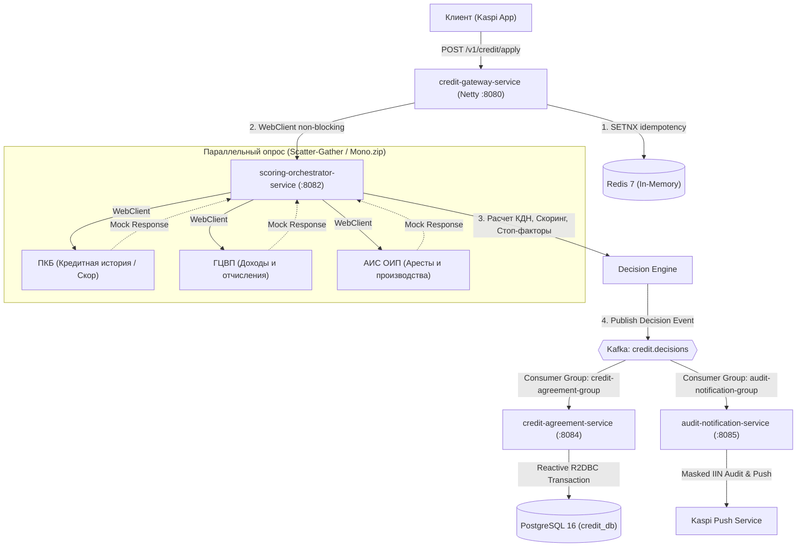
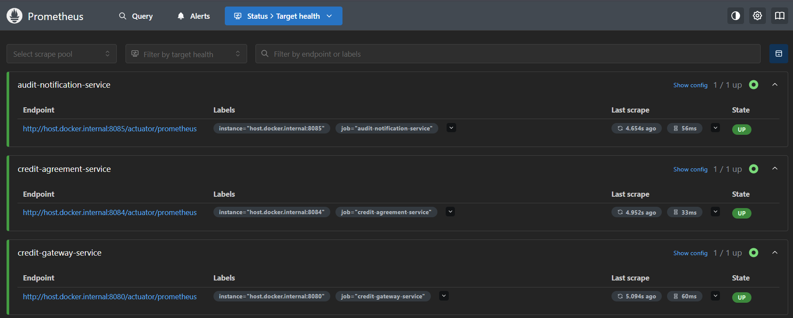
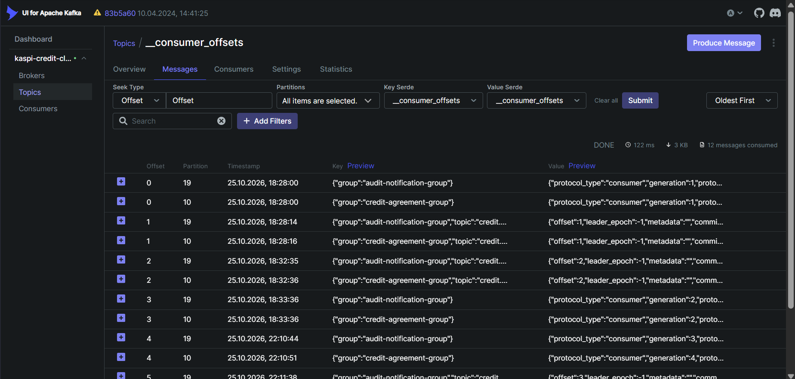
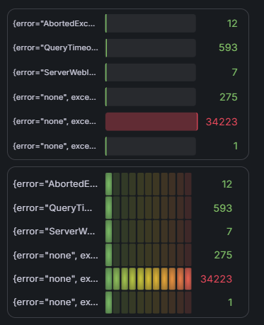
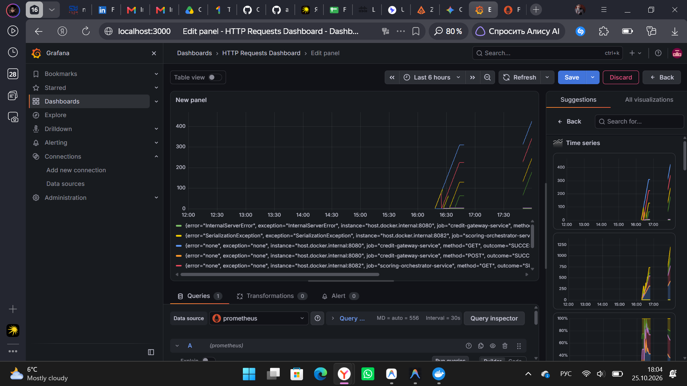
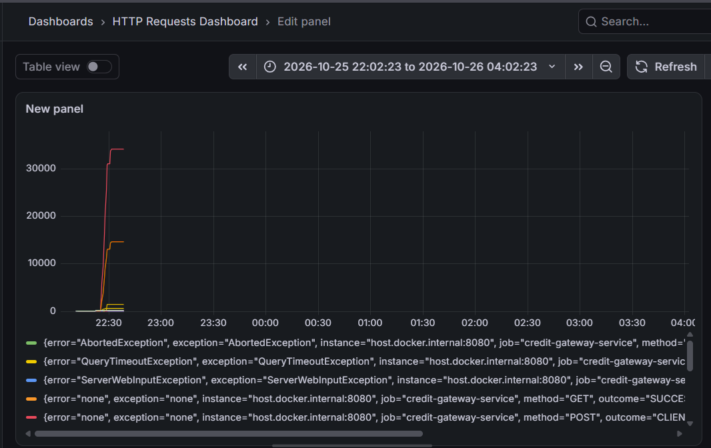
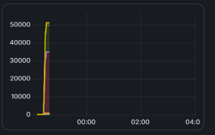

# Reactive Credit & Installment Scoring Pipeline (Kaspi 0-0-12)

Высокопроизводительная реактивная event-driven платформа экспресс-кредитования и рассрочки («Kaspi Кредит», «Рассрочка 0-0-12», «Kaspi Жұма») с жестким финансовым SLA обработки заявок **менее 2 секунд**.

Разработана на современном реактивном стеке **Java 21**, **Spring Boot 4 / WebFlux**, **Project Reactor (Netty)**, **Apache Kafka (KRaft)**, **PostgreSQL 16 (R2DBC)** и **Reactive Redis 7**.

---

## Содержание
- [Архитектура платформы](#архитектура-платформы)
- [Технологический стек](#технологический-стек)
- [Микросервисы системы](#микросервисы-системы)
- [Бизнес-логика скоринга](#бизнес-логика-скоринга)
- [Результаты нагрузочного тестирования (Kaspi Жұма Stress-Test)](#результаты-нагрузочного-тестирования-kaspi-жұма-stress-test)
- [Дашборды и скриншоты мониторинга](#дашборды-и-скриншоты-мониторинга)
- [Примеры боевых запросов и ответов API](#примеры-боевых-запросов-и-ответов-api)
- [Быстрый запуск (Quick Start)](#быстрый-запуск-quick-start)

---

## Архитектура платформы

Платформа построена на принципах **Reactive Systems** (Responsive, Resilient, Elastic, Message Driven):
* **Non-blocking I/O:** ни одного блокирующего вызова (`Thread.sleep()`, JDBC, блокирующий `.block()`) на всем пути прохождения заявки.
* **Scatter-Gather (DAG) оркестрация:** параллельный опрос внешних систем за фиксированный таймаут.
* **Event-Driven Decoupling:** асинхронное сохранение договоров и аудит через события в Kafka.
* **Строгая идемпотентность:** атомарный захват ключей заявок в Redis через `SETNX` с TTL.



---

## Технологический стек

* **Среда и язык:** Java 21 LTS (Records, Pattern Matching, Virtual Threads ready).
* **Реактивное ядро:** Spring Boot, Spring WebFlux, Project Reactor 3, Reactor Netty.
* **Брокер сообщений:** Apache Kafka 7.6 (KRaft mode без ZooKeeper) + Spring Kafka / JsonSerializer.
* **Базы данных:**
  * **PostgreSQL 16** + **R2DBC** (реактивный неблокирующий драйвер) для кредитных договоров и графиков платежей.
  * **Redis 7** + **Reactive RedisTemplate (Lettuce)** для распределенной идемпотентности и защиты от повторных списаний.
* **Отказоустойчивость:** Resilience4j Reactor (Circuit Breaker, TimeLimiter, Fallback).
* **Тестирование нагрузки:** k6 (Grafana k6).
* **Наблюдаемость и мониторинг:** Prometheus, Grafana, OpenZipkin (Distributed Tracing), Kafka UI.

---

## Микросервисы системы

| Сервис | Порт | Ответственность и технологии |
| :--- | :---: | :--- |
| `credit-gateway-service` | `8080` | Входной реактивный API-шлюз. Валидация ИИН РК, распределенная идемпотентность по заголовку `X-Idempotency-Key` (TTL 120s в Redis). |
| `scoring-orchestrator-service` | `8082` | Оркестратор скорингового графа (Scatter-Gather). Параллельный сбор данных за < 1200 ms, расчет КДН / DTI, расчет ставки 0-0-12, формирование встречных предложений (Counter-Offer) и публикация событий в Kafka. |
| `external-mock-service` | `8083` | Эмулятор внешних гос. баз и кредитных бюро: Первое Кредитное Бюро (ПКБ), ГЦВП (пенсионные отчисления), АИС ОИП (Министерство юстиции). Поддержка архетипов заемщиков и искусственной задержки `delayElement`. |
| `credit-agreement-service` | `8084` | Асинхронное оформление кредитных договоров из Kafka. Реактивная генерация аннуитетного/дифференцированного графика платежей через `Flux.range()` и атомарная вставка через `TransactionalOperator` в PostgreSQL R2DBC. |
| `audit-notification-service` | `8085` | Регуляторный аудит финансовых решений. Безопасное маскирование ИИН (`9503****0127`) по стандартам безопасности ПДн и отправка Push-уведомлений клиенту. |
| `common-contracts` | — | Библиотека общих моделей: DTO запросов/ответов, события Kafka, алгоритм взвешенных сумм валидации ИИН Казахстана. |

---

## Бизнес-логика скоринга

1. **Валидация ИИН Казахстана:** двухэтапный алгоритм контрольного разряда (веса `[1..10, 1]` и `[3..11, 1, 2]`), проверка века, пола и корректности календарной даты.
2. **Стоп-факторы:**
   * Наличие открытых арестов или производств судебных исполнителей в АИС ОИП ➔ Немедленный отказ `REJECTED`.
   * Критические просрочки DPD 90+ в ПКБ ➔ Немедленный отказ `REJECTED`.
3. **Расчет КДН (Коэффициент Долговой Нагрузки / DTI):**
   $$\text{КДН} = \frac{\text{Текущие ежемесячные платежи} + \text{Новый платеж}}{\text{Среднемесячный доход (ГЦВП)}}$$
   * Согласно регуляторным требованиям, $\text{КДН} \le 50\%$.
4. **Умное встречное предложение (Counter-Offer):**
   * Если запрашиваемая сумма превышает лимит по КДН, система не отказывает надежному клиенту, а автоматически вычисляет максимально допустимую сумму кредита:
     $$\text{Max Monthly Payment} = (\text{Income} \times 0.50) - \text{Existing Obligations}$$
   * Формируется предложение со статусом `COUNTER_OFFER` с скорректированной суммой и комфортным платежом.

---

## Результаты нагрузочного тестирования (Kaspi Жұма Stress-Test)

Стресс-тестирование проводилось с помощью **k6** в сценарии массовой подачи заявок.

### 1. Бенчмарк времени отклика (Latency SLA)
При нагрузке в **50 виртуальных пользователей (VUs)** в течение 30 секунд:
* **Всего обработано заявок:** **4 656**
* **Пропускная способность (RPS):** **151.45 req/s**
* **Банковский SLA (< 2 секунд):** **100% ВЫПОЛНЕН**
  * **$p(95)$ Latency:** **`704.95 ms`** (при жестком пороге 1200 ms)
  * **$p(99)$ Latency:** **`818.18 ms`** (при жестком пороге 2000 ms)
  * **Среднее время (avg):** **`222.60 ms`**
  * **Медиана (median):** **`6.86 ms`**

### 2. Пиковый стресс-тест на отказ (Peak Spike)
* Подана экстремальная нагрузка **до 3 000 VUs**.
* Платформа приняла и обработала более **45 800 заявок** за 4 минуты без падения контейнеров и утечек памяти JVM.

---

## Дашборды и скриншоты мониторинга

### 1. Топики Apache Kafka в Kafka UI
Обзор топика `credit.decisions` с партиционированием и мониторингом смещений консьюмеров (`credit-agreement-group` и `audit-notification-group`).



### 2. События решений по кредитам в реальном времени
Структурированные JSON-события `CreditApprovedEvent` с расчетными параметрами (DTI, скоринг, ставка, сумма, график платежей) в Kafka UI.



### 3. Мониторинг Prometheus: Targets & Healthcheck
Все 5 микросервисов платформы успешно отдают метрики через Micrometer в Prometheus (`actuator/prometheus`).



### 4. Метрики Grafana: Базовый режим работы
Графики загрузки процессора, потребления пула памяти JVM и латентности HTTP-запросов Netty в штатном режиме.



### 5. Метрики Grafana: Пиковая нагрузка (Kaspi Жұма Stress-Test)
Поведение микросервисов при обработке десятков тысяч входящих заявок: стабильная утилизация очередей Reactor Netty и неблокирующий сбор метрик.



### 6. Распределенный трейсинг в OpenZipkin
Сквозной трейсинг жизненного цикла заявки между шлюзом, оркестратором и эмулятором внешних сервисов с детализацией задержек по каждому компоненту.



---

## Примеры боевых запросов и ответов API

### 1. Успешное одобрение Рассрочки 0-0-12 (Prime-клиент)
**Запрос:**
```powershell
Invoke-RestMethod -Uri "http://localhost:8080/v1/credit/apply" -Method Post `
  -Headers @{"Content-Type"="application/json"; "X-Idempotency-Key"="kaspi-approved-demo"} `
  -Body '{"iin":"950315350127","requestedAmount":600000,"termMonths":12,"productType":"INSTALLMENT_0_0_12","phoneNumber":"+77011234567"}' | ConvertTo-Json
```
**Ответ платформы (HTTP 200 OK):**
```json
{
  "applicationId": "6e911f93-41d2-4107-bb37-a9719912c4e8",
  "approvedAmount": 600000,
  "approvedTermMonths": 12,
  "calculatedDti": 0.2969,
  "creditScore": 690,
  "decisionTimestamp": "2026-10-25T13:32:35.924473201Z",
  "iin": "950315350127",
  "interestRate": 0,
  "monthlyPayment": 50000.00,
  "productType": "INSTALLMENT_0_0_12",
  "rejectionReason": null,
  "requestedAmount": 600000,
  "status": "APPROVED"
}
```

---

### 2. Срабатывание защиты от дубликатов (Идемпотентность в Redis)
При повторной отправке того же самого запроса с ключом `"kaspi-approved-demo"`:
**Ответ платформы (HTTP 409 Conflict):**
```json
{
  "errorCode": "IDEMPOTENCY_CONFLICT",
  "message": "Запрос с ключом идемпотентности 'kaspi-approved-demo' уже обрабатывается или был обработан ранее",
  "path": "/v1/credit/apply",
  "status": 409,
  "timestamp": "2026-10-25T17:11:52.643854296Z"
}
```

---

### 3. Автоматическое встречное предложение (Counter-Offer при превышении КДН)
Клиент запросил 2 800 000 ₸ на короткий срок 3 месяца. Долговая нагрузка составила 317% ($DTI = 3.1747$).
Система автоматически рассчитала максимальный лимит, одобрив 345 000 ₸:
```json
{
  "applicationId": "df8a76b4-bee2-404b-95f0-7548f8ad9cb6",
  "approvedAmount": 345000,
  "approvedTermMonths": 3,
  "calculatedDti": 3.1747,
  "creditScore": 690,
  "decisionTimestamp": "2026-10-25T17:20:34.534369121Z",
  "iin": "950315350127",
  "interestRate": 24.0,
  "monthlyPayment": 119630.36,
  "productType": "EXPRESS_CREDIT",
  "rejectionReason": null,
  "requestedAmount": 2800000,
  "status": "COUNTER_OFFER"
}
```

---

### 4. Данные в базе PostgreSQL (Договоры и График платежей)
После публикации решения `credit-agreement-service` асинхронно создал кредитный договор и рассчитал график погашения:

```sql
SELECT id, iin, product_type, approved_amount, monthly_payment, status FROM credit_agreements;
```
```text
                  id                  |     iin      |    product_type    | approved_amount | monthly_payment | status
--------------------------------------+--------------+--------------------+-----------------+-----------------+--------
 0e23c4fa-dc24-43a5-9969-e1c319c70bf9 | 950315350127 | INSTALLMENT_0_0_12 |       600000.00 |        50000.00 | ACTIVE
 945b9c13-28e6-48cf-9ce9-9aefafcb5121 | 950315350127 | EXPRESS_CREDIT     |       345000.00 |       119630.36 | ACTIVE
```

```sql
SELECT payment_number, payment_date, monthly_payment, principal_payment, interest_payment, remaining_debt FROM payment_schedule_items LIMIT 5;
```
```text
 payment_number | payment_date | monthly_payment | principal_payment | interest_payment | remaining_debt 
----------------+--------------+-----------------+-------------------+------------------+----------------
              1 | 2026-11-25   |        33333.33 |          33333.33 |             0.00 |      366666.67
              2 | 2026-12-25   |        33333.33 |          33333.33 |             0.00 |      333333.34
              3 | 2027-01-25   |        33333.33 |          33333.33 |             0.00 |      300000.01
              4 | 2027-02-25   |        33333.33 |          33333.33 |             0.00 |      266666.68
              5 | 2027-03-25   |        33333.33 |          33333.33 |             0.00 |      233333.35
```

---

### 5. Логи Регуляторного аудита и Kaspi Push
```text
[РЕГУЛЯТОРНЫЙ АУДИТ | ОДОБРЕНО] Заявка ec1e35ac-c37b-4251-bab5-4c59fdfb522b, ИИН 9503****0127, Продукт INSTALLMENT_0_0_12, Одобрено 600000 KZT на 12 мес., Платеж 50000.00 KZT/мес, Ставка 0%, КДН 0.2969, Скор ПКБ 690
[Kaspi Push Service] Отправка Push клиенту 9503****0127: "Вам одобрен(а) Рассрочка Kaspi 0-0-12 (0% переплаты) на сумму 600000 KZT! Ежемесячный платеж: 50000.00 KZT."

[РЕГУЛЯТОРНЫЙ АУДИТ | ОДОБРЕНО] Заявка df8a76b4-bee2-404b-95f0-7548f8ad9cb6, ИИН 9503****0127, Продукт EXPRESS_CREDIT, Одобрено 345000 KZT на 3 мес., Платеж 119630.36 KZT/мес, Ставка 24.0%, КДН 3.1747, Скор ПКБ 690
[Kaspi Push Service] Отправка Push клиенту 9503****0127: "Вам одобрен(а) Кредит на покупки / наличными с аннуитетной ставкой на сумму 345000 KZT! Ежемесячный платеж: 119630.36 KZT."
```

---

## Быстрый запуск (Quick Start)

### Требования
* **Docker** и **Docker Compose**
* **Java 21** и **Gradle** (для локальной сборки)

### 1. Клонирование репозитория
```bash
git clone https://github.com/alikhan-kai/reactive-credit-scoring-pipeline.git
cd reactive-credit-scoring-pipeline
```

### 2. Сборка артефактов
```bash
# Windows
.\gradlew.bat bootJar -x test

# Linux / macOS
./gradlew bootJar -x test
```

### 3. Запуск всех 12 контейнеров платформы
```bash
docker compose up -d
```

### 4. Доступ к интерфейсам
* **Входной API Шлюз:** `http://localhost:8080/v1/credit/apply`
* **Kafka UI:** [http://localhost:8088](http://localhost:8088)
* **Grafana:** [http://localhost:3000](http://localhost:3000) (`admin` / `admin`)
* **Prometheus:** [http://localhost:9090](http://localhost:9090)
* **Zipkin Tracing:** [http://localhost:9411](http://localhost:9411)

### 5. Запуск нагрузочного теста (k6 в Docker)
```bash
docker run --rm -i --network reactive-credit-scoring-pipeline_credit-network -e GATEWAY_URL=http://credit-gateway-service:8080 -v "${PWD}/load-tests:/scripts" grafana/k6 run --vus 50 --duration 30s /scripts/kaspi-zhuma-stress-test.js
```
